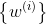
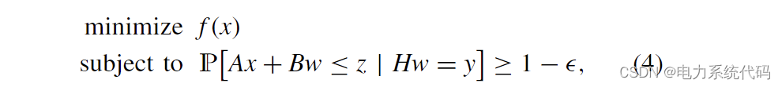
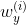
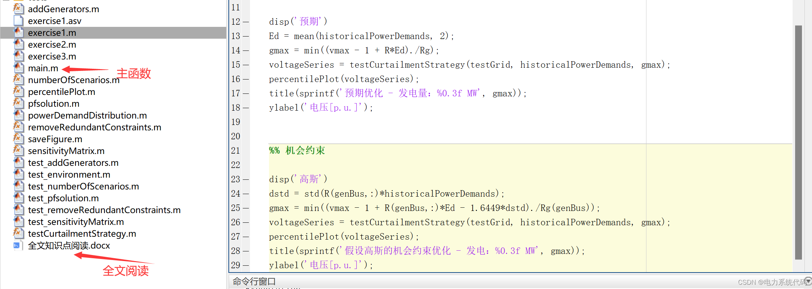
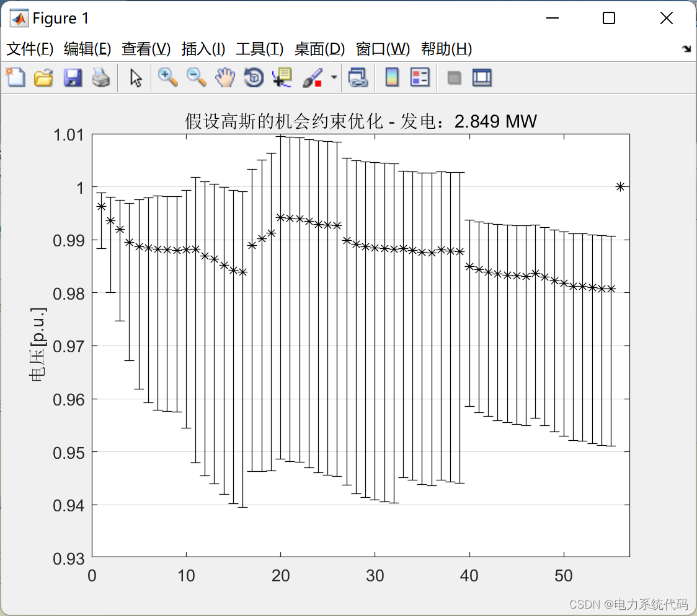
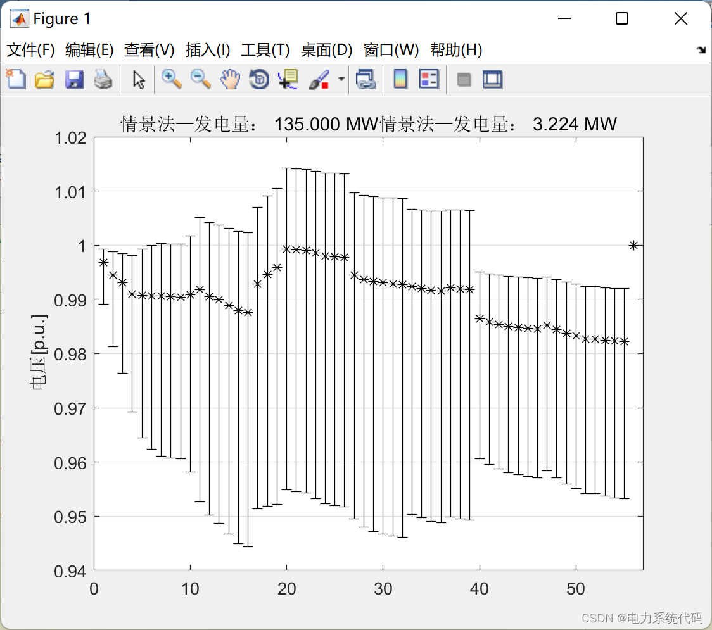
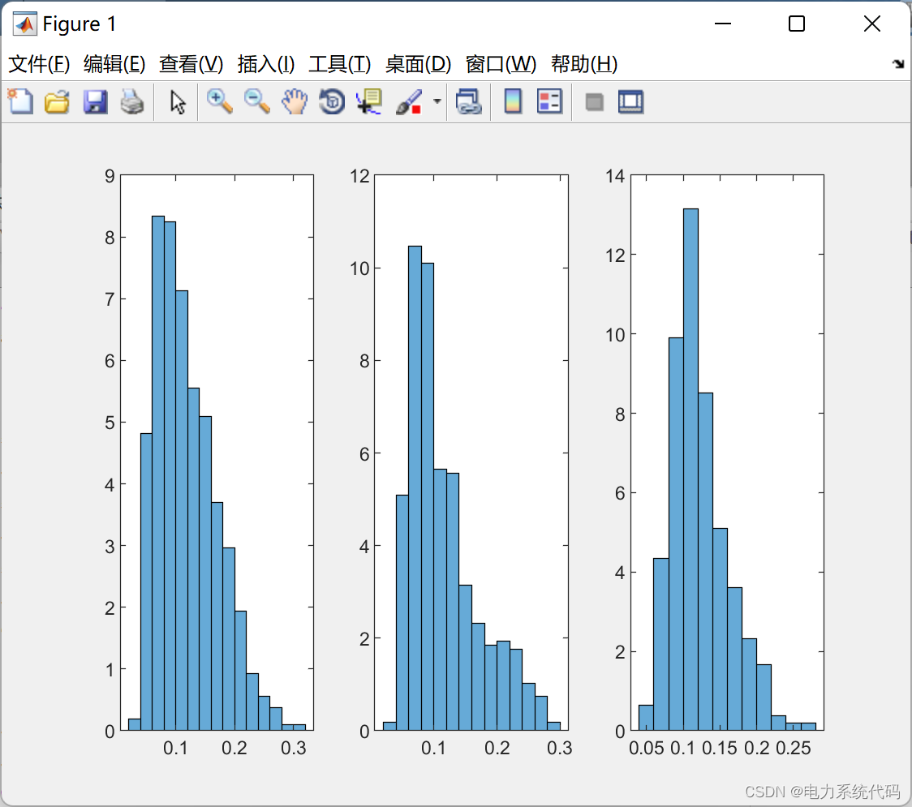
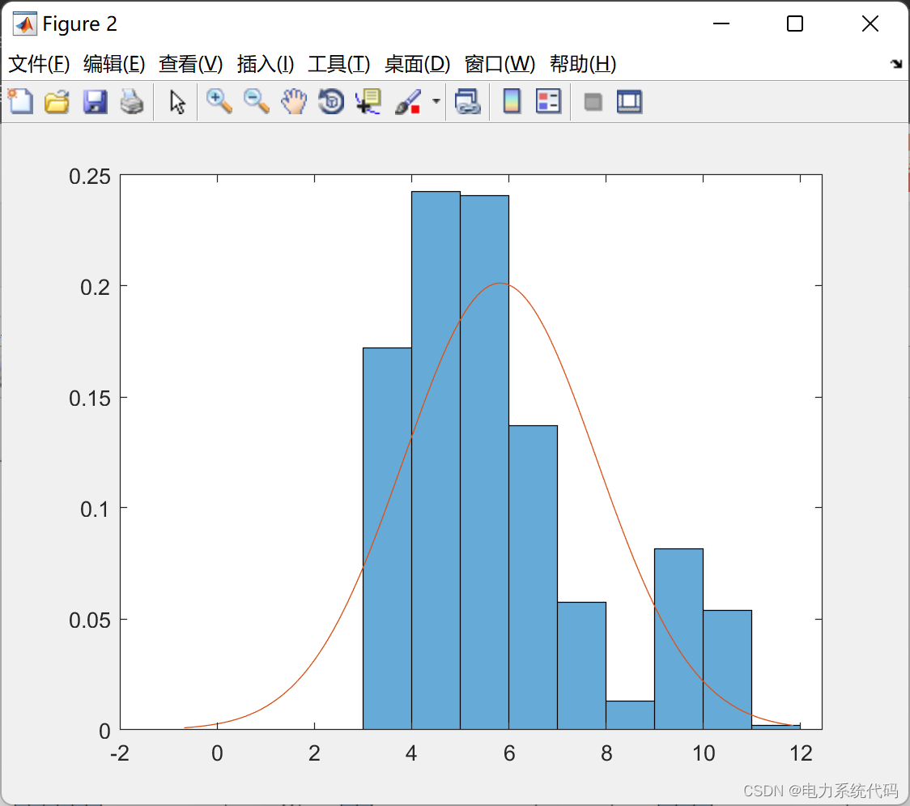
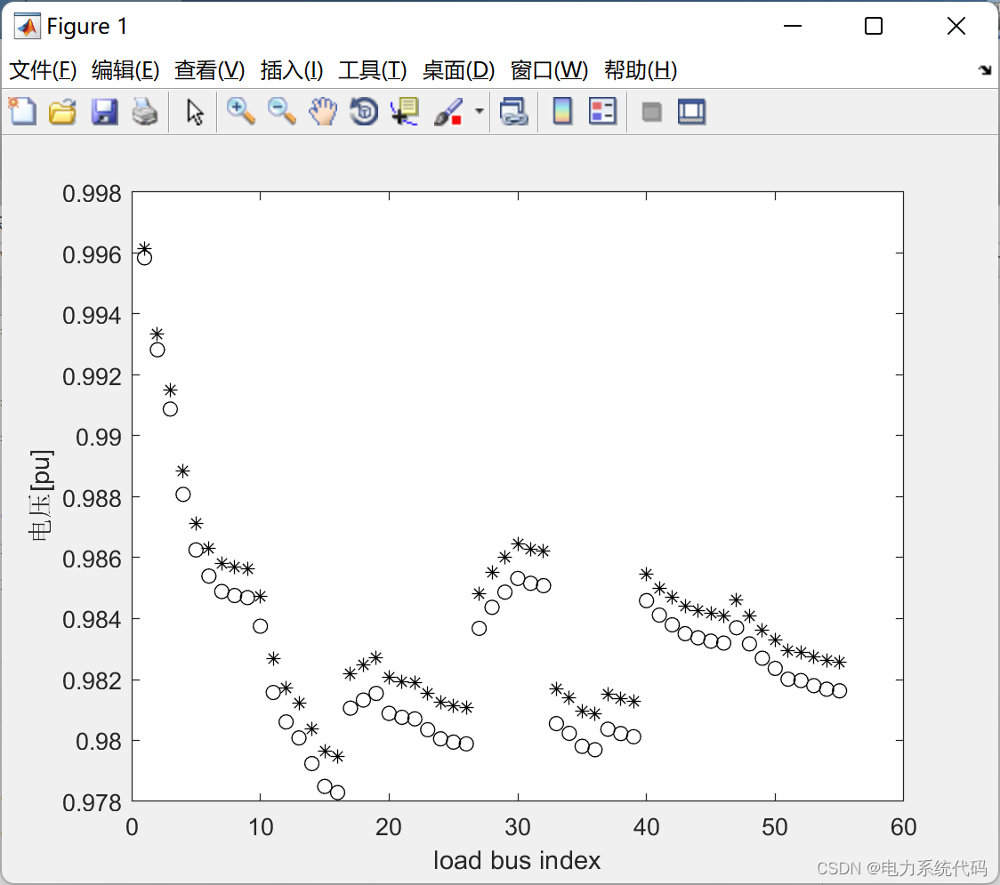

# Real-time opportunity-constrained decision making and its application in power systems (Matlab code implementation)

​  
Contents
I. Overview
II. Mathematical Model
2.1 Scenario-based approach to opportunity constrained decision making
2.2 Measurement-based scenario method
III. A Fast Method for Opportunity-constrained Decision Making
3.1 Approximate adjustment through affine transformation
3.2 Affine transformation of the feasible region
3.3 Two-stage decision algorithm
IV. Example - Power Distribution Network
4.1 Power Reduction to Prevent Overvoltage
4.2 Numerical Simulation
4.3 MATLAB implementation
4.4 Running Results
Editor
Column Directory Search: *The Beauty of Power Systems and Algorithms (Python & Matlab Code)
I. Overview Many engineering problems can be described as instances of decision-making under uncertainty, i.e., when the parameters of a problem are uncertain, making decisions that satisfy certain given constraints while being cost-effective. A natural approach is to make a decision that is feasible for any possible acceptable value of the unknown parameters, thus adopting the worst-case paradigm. In some applications, this robust method produces programs that are easy to handle and find optimal solutions. Such solutions may be very conservative in terms of achievable performance: decisions may be influenced by extreme values of the parameters, which are highly unlikely but have a significant impact on the feasible region for seeking optimal decisions.
The second method involves the formulation of what is known as an opportunity-constrained decision problem. In these problems, it is permissible to violate constraints in the parameter space for a set of parameters that have the smallest probability measure, thus making it unlikely to be achieved. This method allows for a trade-off between safety (the probability of violating constraints) and performance (decision costs). Opportunity-constrained problems are often non-convex and difficult to solve, even if the original problem with known parameter values is convex. However, they can be effectively solved by adopting a so-called scenario approach, where stochastic constraints are replaced by deterministic ones, obtained through sampling of parameter uncertainty. If the number of constraints is large enough, it is possible to ensure high confidence in the feasibility in terms of opportunity constraints. Conversely, the cost of solutions obtained through this method can also be guaranteed.
In this paper, we consider opportunity-constrained decision problems with specific structures: on one hand, we assume some prior information about the unknown parameters of the decision problem is known in sample form; on the other hand, we assume further information about these parameters' true values can be collected through measurements. We specialize the scenario approach to allow for the effective use of prior samples and available metrics to generate feasible regions satisfying opportunity constraints. This leads to a two-stage algorithm composed of offline preprocessing of samples followed by an online part that must be executed immediately upon availability of measurements. The online part is very lightweight in terms of computational time and memory usage, making it suitable for implementation in embedded systems. As an application considered, we address the control of micro-generators in power distribution networks.
In Section 2, we briefly review the scenario approach and formulate opportunity-constrained decision problems using measurements. In Section 3, we show how to approximate the posterior distribution of unknown parameters and analyze a fast algorithm for solving opportunity-constrained decision problems. In Section 4, we explain the effectiveness of the proposed real-time operation algorithm for power distribution networks.
In which x ∈ Rn is the decision variable, f (x) is a convex cost, w is an unknown disturbance modeled as a random variable, and c is a constant term. We assume that the support of the random variable w is assigned to a σ-algebra D and P is defined on D. Finally, ∈ (0, 1) is the probability of violation of the constraints with respect to expectation.
General opportunity-constrained decision problems are non-convex and often computationally difficult to handle. Please note that we assume the linear constraints are affine in the random variables. In this case, analytical results can be obtained as long as the basic distribution of w is known, providing conditions for rephrasing the opportunity-constrained problem as a convex problem. In any other scenario, the scenario method converts the stochastic program into a deterministic problem of this form:
Editor
Among them are N random samples. If N is large enough, then this mathematical description is equivalent to the one above.
The scene method is notably absent in distribution, implying no assumptions have been made about the probability distribution of interference w. However, this characteristic of the scene method still implicitly contains information about the distribution of w. This feature makes the scene method particularly appealing for applications where reliable first-principle models of interference cannot be obtained but historical data can be used.
2.2 In certain applications, the online information about interference w may be available through measurement-based scenarios. For example, although prior information about the distribution of w may be available in advance, direct measurements may be conducted during decision-making. We formulate the opportunity-constrained decision problem with measurement opportunities as follows:
In which y = Hw is a linear measurement of the perturbation, where H is the full row rank, representing the conditional probability. The direct application of the scenario method, as in (3), will result in deterministic optimization equations of the form:
Editor
The sample is determined by the conditional probability distribution of y = Hw.
The final configuration seems to negate the effectiveness of real-time operation scenarios, as sample editing is involved.
Only when y is available for measurement is it necessary to generate. The use of historical samples makes the integration of this new information difficult. Furthermore, The optimization problem (5) still has a large number of typical redundant constraints. This poses a computational challenge for direct use of the scenario-based method for rapid real-time decision making. In the next section. We will show how to successfully solve these two problems by offline preprocessing stage of the sample. Then comes the decision-making steps for online measurement driving.
3. A Fast Method for Opportunity-constrained Decision Making 3.1 Approximate Regulation via Affine Transformation 3.2 Affine Transformation of the Domain of Feasibility 3.3 Two-Stage Decision Algorithm Example - Power Distribution Network 4.1 Reduction of Active Power to Prevent Overvoltage 4.2 Numerical Simulation 4.3 Matlab Implementation Here, only a portion of the code is shown. All code can be found in:
Editor
%% ====Robust Optimization===========\n\ndisp('Robust')\ngmax = (vmax - 1) / max(Rg);\nvoltageSeries = testCurtailmentStrategy(testGrid, historicalPowerDemands, gmax);\npercentilePlot(voltageSeries);\ntitle(sprintf('Robust optimization - Power generation: % 0.3f MW', gmax));\nylabel('Voltage [p.u.]');\n\n%% Expected\n\ndisp('Expected')\nEd = mean(historicalPowerDemands, 2);\ngmax = min((vmax - 1 + R*Ed)./Rg);\nvoltageSeries = testCurtailmentStrategy(testGrid, historicalPowerDemands, gmax);\npercentilePlot(voltageSeries);\ntitle(sprintf('Expected optimization - Power generation: %0.3f MW', gmax));\nylabel('Voltage[p.u.]');\n\n\n%% Opportunity Constraints\n\ndisp('Gauss')\ndstd = std(R(genBus,:)*historicalPowerDemands);\ngmax = min((vmax - 1 + R(genBus,:)*Ed - 1.6449*dstd)./Rg(genBus));\nvoltageSeries = testCurtailmentStrategy(testGrid, historicalPowerDemands, gmax);\npercentilePlot(voltageSeries);\ntitle(sprintf('Assume Gaussian opportunity-constrained optimization - Power generation: %0.3f MW', gmax));\nylabel('Voltage[p.u.]');\n  
4.4 Running Results Editing
Editor
Editor
Editor
Editor
​  

## Images

<!-- PAYMENT_BLOCK -->

## Get this dataset

- Payment link (Stripe): [Buy now](https://buy.stripe.com/3cs8yP7sY87d0vu9AB)
- Payment QR code: 

<!-- /PAYMENT_BLOCK -->
